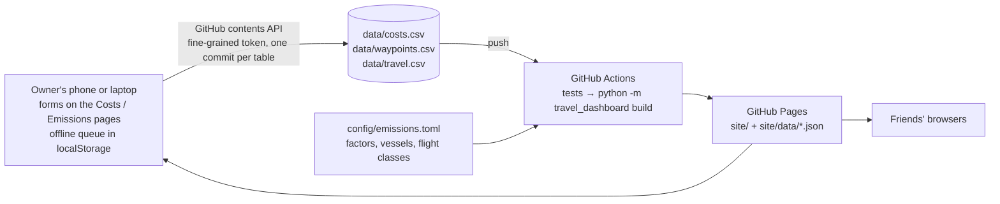

# Travel dashboard: architecture and roadmap

> Updated 2026-10-18 after the first implementation. Methodology: [METHODOLOGY.md](METHODOLOGY.md).
> The first design mockup (illustrative numbers) is in [`prototype/`](../prototype/).

## 1. What it is

A static site on GitHub Pages with two separate pages, each with its own input, plus a Method page:

| page | shows | input (owner only) |
|---|---|---|
| **Costs** | totals and averages per day, week, month; by category; per day per country; entries | amount (CHF), date, category, country |
| **Emissions** | avoided emissions with ranges, every lens combination, route with alternative arcs, cumulative chart, journeys, method check, g/pkm, every leg with its arithmetic | waypoints (stop/destination), legs, alternatives |
| **Method** | the emissions method in plain language: what counts, the switches, ferries under ISO 14083 with the trip's own ships, non-CO₂, grades, a toggleable table of default factors per mode and named vehicle | none |

Friends open the site and read it. Only the owner can edit, because edits need a GitHub token that
lives in the owner's browser. The edit UI is hidden everywhere else.

## 2. Architecture



- **Git is the database.** Three small CSV files, editable from the site, by hand or by Claude.
- **Python owns the emissions model.** It is standard library only: no install step, and the build
  takes about a second.
- **The pages are plain HTML + ES modules + d3,** with no build step. A service worker keeps the app
  usable offline.

## 3. Data

| file | columns | notes |
|---|---|---|
| `costs.csv` | `id, date, amount, category, country` | `amount` in CHF; categories: groceries, coffee, treats, activities, accommodation, transport, restaurants, other |
| `waypoints.csv` | `id, name, type, country, arrive, depart, note` | `type` = `destination` or `stop`, set by hand; ordered by dates (ties follow the legs) |
| `travel.csv` | `id, type, option, main, date, from, to, mode, vehicle, km, occ_max, occ_obs, fuel_l, note` | `type` = `leg` or `alt`; `from`/`to` = waypoint ids; `km` by hand |

How alternatives work:

- Alternative rows with the same `option` name form one chain. Intermediate points are plain text,
  e.g. `tenerife-2 → Paris Orly → martinique`.
- An option replaces every leg between its first and last waypoint.
- Several options may share a span; `main = 1` picks the one that counts. The others appear as
  hollow dots for comparison.

Modes: `train`, `bus`, `coach`, `ferry`, `fast_ferry`, `plane`, `car`, `taxi`, `sail`, `bike`,
`walk`, `other`. The `vehicle` text is matched against `config/emissions.toml` to pick specific
data, e.g. "Bencomo Express" or "TGV Lyria".

## 4. The comparison

Details in METHODOLOGY.md §3:

- **Destination level** (default): one journey per pair of consecutive destinations, compared with
  the main option spanning exactly that pair.
- **Every stop:** inside each destination span, stop-level options are used where they tile the
  whole span; elsewhere the destination-level option stays.
- **Lenses:** level (2) × ferry share (3) × occupancy (2) × flights' non-CO₂ (2) = 24 scenarios,
  each with 2,000 Monte Carlo draws. The page switches between them and shows all 24 at once in the
  robustness strip.
- **Scopes:** "trip so far" and "including planned travel". A journey switches to its alternative
  on the date of its last leg.

## 5. Pipeline (`travel_dashboard/`)

```
tables.py      read + validate the CSVs → typed rows + issues (fix-ups, skipped rows)
profiles.py    config → parameters per travel row (mode defaults + matched vehicle), shared sampling
model.py       per-passenger kg for one draw and lens: factor | vehicle | fuel | ship | flight; traces
trip.py        waypoint order, alternative chains, journeys per level
montecarlo.py  24 lens combinations × draws → p5/p50/p95 per travel, option, journey, total, day
costs.py       normalise cost rows + summary
export.py      site/data/{emissions,costs,meta}.json (the data contract)
cli.py         build | check | serve
```

## 6. Site (`site/`)

| part | role |
|---|---|
| `index.html` | landing, with one headline number per page |
| `costs/` and `costs.js` | the page sums cost rows itself, so the owner sees new entries immediately |
| `emissions/` and `emissions.js` | charts from `emissions.json`; trip editor grouped by journey, with "+ Leg" / "+ Alternative" prefilled for each span |
| `store.js` | CSV parse/serialise, offline queue, one commit per table via the contents API; re-reads the file before writing, so other edits survive |
| `editor.js` | forms, owner sign-in |
| `sw.js` | caches the app shell and the last data for offline use; never caches the API |

## 7. Deployment

`.github/workflows/build.yml`:

- **Triggers:** every push (including every save from the site), daily at 04:23 UTC, and manual.
- **Steps:** unit tests → data check (reported, never blocking) → build → Pages.
- **One-time setup:** Settings → Pages → Source: GitHub Actions. Then create a fine-grained token
  limited to this repo with Contents read/write, and paste it under "Owner" on the site.

## 8. Privacy

- The Pages site is public to anyone with the link, which is fine for an unlisted share with
  friends.
- If the raw CSVs should be private, make the repo private. That needs GitHub Pro, free with the
  Student Developer Pack.
- If friends-only matters more later, a client-side password gate (StatiCrypt) can wrap the built
  site.

## 9. Decisions so far

| decision | chosen | instead of |
|---|---|---|
| Input | manual forms on the site, CSV in git | GPS logbook, Google Sheets, Notion |
| Pages | costs and emissions fully separate, each with its own input | one combined logbook |
| Costs | CHF only, four fields | currency conversion, notes, splits |
| Waypoint types | stop/destination by hand | a nights-based rule |
| Alternatives | chains of rows per option; one main per span | auto-generated flights |
| Level switch | from waypoint types (destination vs. every stop) | regions grain |
| Ferry freight | vessel's typical load from config | freight level or counts per trip |
| Site | static HTML/JS | Quarto |
| Editing | owner only, via a token in the owner's browser | open forms |

## 10. Next steps

- **Owner:**
  - enable Pages and the token
  - backfill the real trip (Claude can draft the CSVs from a description and tickets)
  - enter the real alternatives
- **Then, as needed:**
  - add vessel entries for the actual mainland ferry and any further ships
  - a great-circle helper for alternative distances from airport codes
  - a budget line on the costs page
  - a "duplicate leg" button
  - a password gate if needed
  - a bank-statement import if typing costs gets tedious
